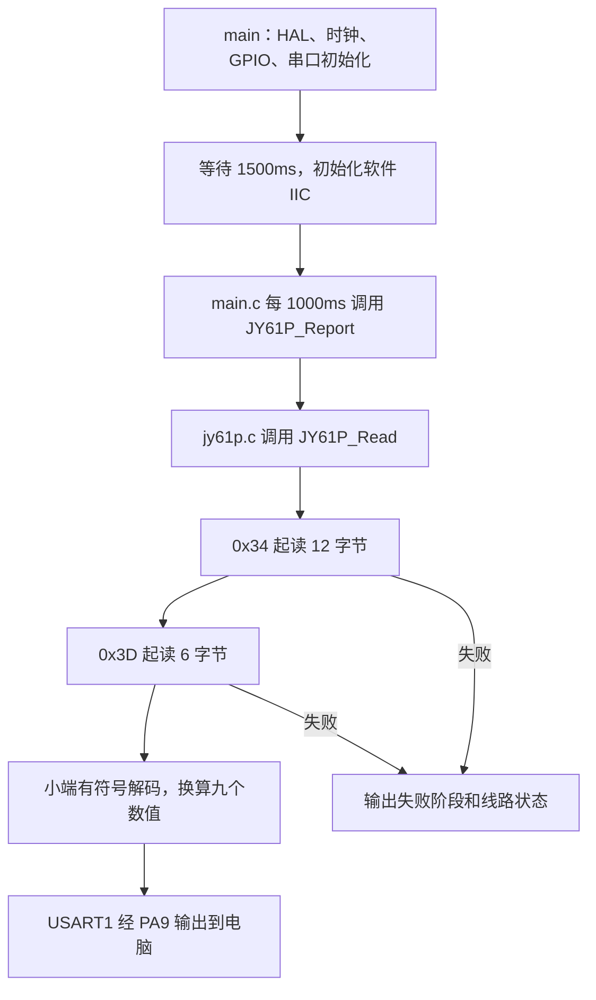

# JY61P 软件 IIC 阅读指南

这份工程复制自 `Gyroscope` 的当前软件 IIC 版本，目标是 **STM32F103C8T6 + JY61P**。STM32 用 **PB6/SCL、PB7/SDA** 读取传感器，通过 **PA9/USART1 每秒输出一次**加速度、角速度和欧拉角。程序不写传感器配置，也不在 STM32 上自行解算姿态。

## 1. 先记住这六件事

| 要点 | 本工程的实际值/含义 |
| --- | --- |
| IIC / I2C / I²C | 同一种总线的不同写法；两根信号线是 SCL 和 SDA |
| 通信实现 | GPIO 软件模拟；**没有启用硬件 I2C1**，也没有调用 `HAL_I2C_Mem_Read` |
| 设备地址 | 传给软件接口的是 **七位地址 `0x50`**；线上地址字节为写 `0xA0`、读 `0xA1` |
| 寄存器地址 | `0x34` 或 `0x3D`，告诉模块从哪里开始读；它与设备地址是两回事 |
| 一个寄存器 | **16 位 = 两字节，低字节先到**；接口 `length` 的单位是字节 |
| 两次读取 | `0x34` 起读 12 字节，`0x3D` 起读 6 字节；共九个 16 位值 |

## 2. 建议按这个顺序读代码（约 10 分钟）

1. [main.c](Core/Src/main.c)：先看初始化顺序和每秒调用一次 `JY61P_Report` 的主循环。这里不放寄存器和字节时序细节。
2. [jy61p.c](Core/Src/jy61p.c)：看设备地址、两段寄存器读取、低高字节解码及串口输出；[jy61p.h](Core/Inc/jy61p.h) 是 `main.c` 使用的唯一传感器接口。
3. [soft_i2c.h](Core/Inc/soft_i2c.h)：看参数单位和错误枚举。
4. [soft_i2c.c](Core/Src/soft_i2c.c)：先看靠后的 `SoftI2C_ReadRegisters`，对照下面的完整事务。
5. 回到同一文件，看 `WriteByte` / `ReadByte`，理解谁发送数据、谁产生 ACK。
6. 最后看 `Start` / `Stop`、`LineLow` / `LineRelease` / `ClockHigh`，理解引脚如何形成时序。[clock.c](Core/Src/clock.c) 则保存 HSI 8MHz 配置。

第一次阅读可以跳过 `Drivers`、启动文件和系统调用文件，它们负责让应用正常启动和运行。



## 3. 一次读取究竟在线上做了什么

以读取角度 `SoftI2C_ReadRegisters(0x50, 0x3D, angles, 6)` 为例：

```text
S → A0 → ACK → 3D → ACK → Sr → A1 → ACK
  → Roll低  → ACK → Roll高  → ACK
  → Pitch低 → ACK → Pitch高 → ACK
  → Yaw低   → ACK → Yaw高   → NACK → P
```

| 步骤 | 哪一方在做什么 | 对应代码 |
| --- | --- | --- |
| S | STM32 产生 START | 第一次 `Start()` |
| A0 | STM32 发 `(0x50 << 1) \| 0`，方向是写 | 第一次 `WriteByte` |
| 第一个 ACK | JY61P 确认收到了设备地址 | `WriteByte` 第 9 个时钟读 SDA |
| 3D | STM32 发读取起点；这里只设置寄存器指针，不写配置值 | `WriteByte(reg, ...)` |
| 第二个 ACK | JY61P 确认收到了寄存器编号 | 同上 |
| Sr | STM32 产生重复 START，中间不发 STOP | 第二次 `Start()` |
| A1 | STM32 发 `(0x50 << 1) \| 1`，切换到读方向 | 第三次 `WriteByte` |
| 第三个 ACK | JY61P 确认读地址 | 同上 |
| 6 个数据字节 | JY61P 发送，STM32 接收；前 5 字节后 STM32 回 ACK | 循环 `ReadByte` |
| NACK | STM32 在最后一字节后表示“收完了” | `ReadByte(..., last=1)` |
| P | STM32 产生 STOP，结束这次事务 | `Stop()` |

**读寄存器为什么先写？** 要先告诉模块“我要从哪个寄存器开始”，再切换到读方向取数据。这里的“写方向”不等于改动模块配置。

**别混淆两种顺序：** 每一个字节在 IIC 线上都是 **bit7 先发**；而这个模块的一个 16 位数值由两个字节组成，是 **低字节先发**。两者完全兼容。

逻辑分析仪若显示七位地址，会看到 `0x50 Write`、`0x50 Read`；若显示原始八位地址字节，则看到 `0xA0`、`0xA1`。不要把 `0xA0` 再传给本软件接口，否则参数检查会失败。

## 4. 数据在哪里，怎样变成物理量

以下映射来自原工程和本地协议资料，与当前读取逻辑一致。

| 寄存器 | 含义 | 缓冲区位置 | 换算 |
| --- | --- | --- | --- |
| `0x34` | AX | `motion[0..1]` | raw × 16 / 32768，单位 g |
| `0x35` | AY | `motion[2..3]` | 同上 |
| `0x36` | AZ | `motion[4..5]` | 同上 |
| `0x37` | GX | `motion[6..7]` | raw × 2000 / 32768，单位 °/s |
| `0x38` | GY | `motion[8..9]` | 同上 |
| `0x39` | GZ | `motion[10..11]` | 同上 |
| `0x3A..0x3C` | 通用协议的磁场区 | 本工程跳过 | 不作为 JY61P 读取项 |
| `0x3D` | Roll，横滚角 | `angles[0..1]` | raw × 180 / 32768，单位 ° |
| `0x3E` | Pitch，俯仰角 | `angles[2..3]` | 同上 |
| `0x3F` | Yaw，航向角 | `angles[4..5]` | 同上 |

`raw` 必须是带符号的 16 位整数。代码先合成 `low | (high << 8)`，若最高位为 1，则减去 65536，得到负数。

```text
收到 00 08 → 0x0800 →  2048 → 加速度  1g
收到 00 F8 → 0xF800 → -2048 → 加速度 -1g
收到 00 40 → 0x4000 → 16384 → 若读的是角度，则为 90°
```

读完一个寄存器的两个字节后，模块进入下一个寄存器，所以从 `0x34` 连读 12 字节就覆盖 `0x34..0x39`。不用给每个寄存器重新发送编号。

换算系数沿用当前协议与原工程；以后更换型号或修改量程配置，应重新核对对应固件协议。两段读取是两次独立事务，程序没有校验它们是否来自同一更新时刻；主机读得快也不代表模块一定产生了新数据。

## 5. 软件 IIC 的引脚和时序

| 操作 | 代码里的做法 |
| --- | --- |
| 拉低 | `LineLow`：先清 GPIO 输出锁存位，再把 PB6/PB7 配为开漏输出 |
| 释放 | `LineRelease`：切换为输入上拉，由弱上拉使线路回到高电平 |
| 读取 | `LineRead`：读取 `GPIOB->IDR` 的实际电平 |
| 拉高时钟 | `ClockHigh`：释放 SCL，确认它实际升高后再继续 |

软件不主动推挽输出高电平，这样传感器可以拉低 SDA 发出数据或 ACK。CRL 中的 `2MHz` 是 GPIO 输出速度档位，**不是 IIC 频率**。本驱动固定写 `GPIOB->CRL`，只适用于当前 PB6/PB7；换到 PB8/PB9 不能只改两个引脚数字。

协议速记：SCL 高时 SDA 下降为 START、上升为 STOP；数据位在 SCL 高时保持稳定。每字节后有第 9 个应答时钟，接收方拉低为 ACK，保持释放为 NACK。相关定义可对照 [NXP I²C 规范 UM10204，第 3.1.3–3.1.6 节](https://www.nxp.com/docs/en/user-guide/UM10204.pdf)。

本程序使用 DWT 周期计数忙等，每次边沿等待约 **50µs**；一位会执行多次等待，不能据此算成 20kHz。沿用 HSI 8MHz、低速软件 IIC、每秒输出的设置。把输出周期改为 10ms，不能直接得到 100Hz 有效采样。

原工程记录过当前连线的成功运行，本副本沿用其内部弱上拉方案；换线、提速时要重新验证上升沿。模块供电遵循模块规格，本工程 IIC 信号上拉电平为 3.3V；不要把模块电源电压直接当作信号上拉电压。

## 6. 接线和观察输出

| STM32 端 | 接到哪里 |
| --- | --- |
| PB6 | JY61P SCL |
| PB7 | JY61P SDA |
| GND | JY61P GND、USB-TTL GND，共地 |
| PA9 / USART1 TX | USB-TTL 的 RX |
| 模块电源 | 按你手头模块规格供电 |

电脑串口设置：**115200、8 数据位、无校验、1 停止位、无流控**。USB-TTL 使用匹配的 3.3V 逻辑电平。JY61P 的 TX/RX 不参与这里的 IIC 读取，PA10 也不参与当前应用。

上电后至少等待 1.5 秒，再观察类似输出（下面仅说明格式）：

```text
ACC(g)=0.000,0.000,1.000 GYRO(deg/s)=0.000,0.000,0.000 ANGLE(deg)=0.000,0.000,0.000
```

`GYRO` 是角速度，`ANGLE` 是模块输出的姿态角；这两组数据不是同一个量。输出包含三位小数，不代表传感器精度就是 0.001。

## 7. 出错先看哪个阶段

| 输出 | 代码实际检测到的情况 | 优先检查 |
| --- | --- | --- |
| `write address NACK` | 发送 `0xA0` 后无应答 | 电源、共地、SCL/SDA 接反、模块地址是否改过 |
| `register NACK` | 地址已获应答，寄存器编号未获应答 | 寄存器协议是否匹配、波形是否可靠 |
| `read address NACK` | 重复 START 后 `0xA1` 无应答 | 读事务时序、线路质量 |
| `bus held low` | 应为空闲时 SDA 仍低，或 STOP 后 SDA 仍低 | 短路、模块状态、上拉是否有效 |
| `timeout` | SCL 未能及时升高，或事务超过时间预算 | SCL 被拉低、异常拉伸、线路/供电问题 |
| `invalid argument` | 地址超过 `0x7F`、空指针或长度为零 | 调用参数，尤其是不要预先左移地址 |

`ClockHigh` 对单次 SCL 等待设置约 2ms 限制，对读取事务设置 100ms 预算。失败后仍会尝试 STOP，因此函数总耗时不能简单视为严格不超过 100ms。总线卡低时还会尝试最多 9 个恢复时钟，这不能修复电气短路。

错误行的 `SCL=... SDA=...` 是清理后的快照，两个都为 1 也不能证明传输时收到过 ACK。读数据最后的 NACK 是主机主动结束读取，**不是**这里的地址/寄存器 NACK 错误。

当前驱动是阻塞式、单调用者设计；不要在多个任务/中断中同时调用，也不要关闭 SysTick 中断后调用，否则超时计时无法正常工作。

## 8. 编译与烧录

这是独立的 **CMake + Ninja + GNU Arm GCC** 工程；不需要旁边的 `Gyroscope` 目录，也不依赖 `.ioc`。没有复制 CubeMX/IDE 配置，避免重新生成覆盖这份精简注释版。

在能找到 `cmake`、`ninja`、`arm-none-eabi-gcc`、`arm-none-eabi-objcopy` 的工具终端中，从本目录执行：

```powershell
cmake --preset Debug
cmake --build --preset Debug
```

如果使用原工程的 STM32 Cube 工具终端，可用原来的包装命令：

```powershell
cube cmake --preset Debug
cube cmake --build --preset Debug
```

找不到编译器或 Ninja 时，将已安装的 GNU Arm GCC 和 Ninja 的 `bin` 目录加入该终端的 `PATH`。不要复制原工程的 `build` 缓存过来。需要优化构建时，将两条命令中的 `Debug` 都改为 `Release`。

每次构建产生：

| 文件 | 用途 |
| --- | --- |
| `build/Debug/Gyroscope_note.elf` | 首选下载/调试文件，含段地址与调试信息 |
| `build/Debug/Gyroscope_note.hex` | 可直接交给烧录软件，含地址 |
| `build/Debug/Gyroscope_note.bin` | 裸机器码；烧录起始地址必须设为 `0x08000000` |

交付目录的 `build/Debug/Gyroscope_note.elf`（本机编译后生成）、`build/Debug/Gyroscope_note.hex`（本机编译后生成）、`build/Debug/Gyroscope_note.bin`（本机编译后生成） 是本次验证生成的 **Debug** 固件。修改源码后应烧录自己新构建的 `build/Debug` 文件；`firmware` 中的交付快照不会自动更新。

使用 STM32CubeProgrammer：连接 ST-LINK 的 SWDIO/PA13、SWCLK/PA14、GND，并按调试器要求接目标参考电压；选择 SWD 连接，打开 ELF 或 HEX，执行下载和校验，再复位运行。芯片为 STM32F103C8T6，链接布局为 64KB Flash、20KB RAM。

这次按模块拆分后，已验证 GCC 14.3.1 下 Debug、Release 均编译成功，无编译警告；Debug Flash 占用 24752 字节，Release 为 21304 字节，两者 RAM 链接占用均为 2456 字节（含链接脚本预留堆栈，不是实测最大栈使用量）。`firmware` 已同步为本次 Debug 构建结果。这次**未烧录、未重新进行传感器实物测试**。

## 9. 为什么还保留这些文件

| 文件/目录 | 保留理由 |
| --- | --- |
| `Core/Src/main.c`、`clock.c` 及头文件 | 应用入口、每秒调度、HSI 时钟配置 |
| `Core/Src/jy61p.c`、`jy61p.h` | 传感器地址和寄存器、数据换算、串口报告接口 |
| `Core/Src/soft_i2c.c`、`soft_i2c.h` | 软件 IIC 的事务和 GPIO 位时序 |
| `gpio.c`、`usart.c`、`stm32f1xx_hal_msp.c` | 引脚、串口和 HAL 底层初始化 |
| `stm32f1xx_it.c`、`system_stm32f1xx.c` | SysTick 毫秒时基、异常入口、系统时钟变量 |
| `syscalls.c`、`sysmem.c` | C 运行库与浮点格式化所需的系统/堆接口 |
| `stm32f1xx_hal_conf.h` | 已精简的 HAL 依赖和时钟配置 |
| `Drivers/STM32F1xx_HAL_Driver` | 只编译 HAL 基础、GPIO、UART、RCC、CORTEX 五个模块；保留所需头文件和许可证 |
| `Drivers/CMSIS` | 仅保留 Cortex-M3、STM32F103xB、GCC 的相关定义和许可证 |
| `startup_stm32f103xb.s`、`STM32F103xx_FLASH.ld` | 复位启动、向量表、Flash/RAM 布局 |
| `CMakeLists.txt`、`CMakePresets.json`、`cmake/gcc-arm-none-eabi.cmake` | 编译入口、Debug/Release 预设、GCC 工具链和烧录格式输出 |

HAL 的 DMA 头文件提供 UART 结构体需要的类型；FLASH/PWR 扩展等头文件提供初始化使用的宏。保留头文件不等于启用了对应外设功能。未参与当前固件的 HAL 源文件已移除，链接器继续裁剪模块内部的未用函数；以后新增 DMA、中断收发或其他功能时，需要补回相应库源文件。

最初精简工程时未复制：硬件 I2C 归档、历史文档、串口协议资料、CubeMX 工程信息、IDE 缓存、旧构建产物、无关内核/编译器头文件、硬件 I2C/LL 驱动。重新编译后本地的 `build/Debug` 和 `build/Release` 是生成目录；`firmware` 保留可直接烧录的 Debug 快照。

资料依据：本地原工程 [IIC.txt](docs/IIC.txt) 的寄存器表、数据换算和读事务说明，以及原 `main.c` / `soft_i2c.c`。原资料混合了 JY-901 等通用协议内容，本指南只摘取当前 JY61P 程序实际用到的部分，不把其他型号的最高速率或功能当作本模块保证。原目录只用于追溯资料，编译完全不依赖它。
